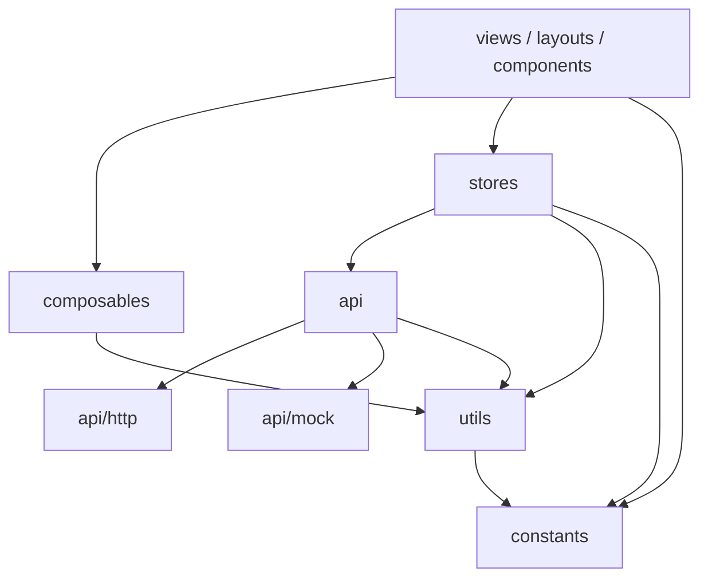
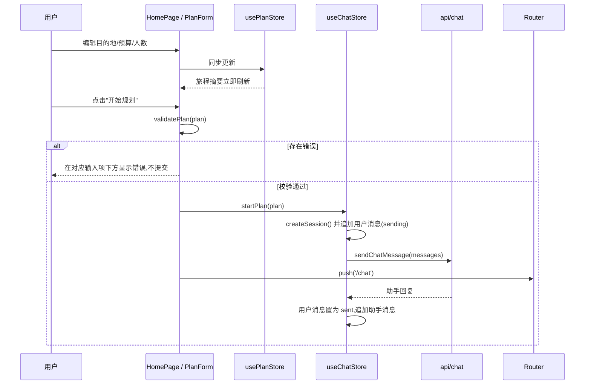
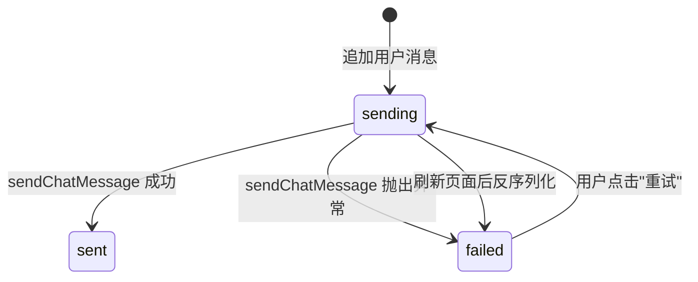

# 架构设计

## 整体分层

依赖方向单向,自上而下:

| 层 | 目录 | 职责 |
| --- | --- | --- |
| 视图层 | `src/views`、`src/layouts`、`src/components` | 页面与组件,只负责渲染与交互 |
| 逻辑层 | `src/composables`、`src/stores` | 可复用的响应式逻辑与全局状态 |
| 数据层 | `src/api` | 接口封装,Mock 与真实后端的切换点 |
| 基础层 | `src/utils`、`src/constants` | 纯函数与常量 |

规则:

- 视图、组件、布局不得直接导入 `axios`,必须经由 `src/api` 发起请求。ESLint 的 `no-restricted-imports` 会拦截违规导入。
- 工具函数不依赖 Vue 组件或 Pinia。
- 常量不依赖其他层(同为常量文件之间可互相引用)。
- 校验、格式化、序列化、时间分隔、布局判定、规划请求文本构造与解析都实现为纯函数,便于测试。

## 三栏布局与布局模式

桌面端为三栏:左侧导航栏、中间主内容、右侧旅程摘要栏。平板和手机根据宽度调整结构。

| 模式 | 宽度 | 结构 |
| --- | --- | --- |
| Desktop | `>= 1200px` | 导航栏(展开) \| 主内容 \| 旅程摘要栏 |
| Tablet | `768px` 至 `1199px` | 导航栏(折叠,仅图标) \| 主内容;旅程摘要通过顶部摘要条打开抽屉 |
| Mobile | `< 768px` | 主内容 / 底部标签栏;旅程摘要通过顶部摘要条打开抽屉 |

断点只在 `src/constants/breakpoints.js` 定义一次:

- `vite.config.js` 导入它,并通过 `css.preprocessorOptions.scss.additionalData` 注入 SCSS 变量 `$mq-tablet-up`、`$mq-desktop-up`。
- `useLayoutMode` 用同一组查询字符串调用 `matchMedia`。

因此 CSS 与 JS 不会出现断点漂移。样式采用移动端优先,只使用 `min-width` 查询,断点之间没有间隙。

"结构性"切换(渲染哪些组件)由 JS 的布局模式决定,"视觉性"切换(列数、气泡宽度、表单排布)由 CSS 媒体查询决定。被隐藏的导航不会留在 Tab 顺序中。

### 布局标志

`getLayoutFlags(mode)` 返回各模式下的结构性渲染标志:

| 标志 | Desktop | Tablet | Mobile |
| --- | --- | --- | --- |
| `showSidebar` | 是 | 是 | 否 |
| `sidebarCollapsed` | 否 | 是 | 否 |
| `showBottomTabBar` | 否 | 否 | 是 |
| `showAsidePanel` | 是 | 否 | 否 |
| `showSummaryBar` | 否 | 是 | 是 |
| `allowAsideDrawer` | 否 | 是 | 是 |

`MainLayout` 的外壳是固定高度的 flex 容器。桌面和平板横向排列;手机纵向排列,主内容与底部标签栏是兄弟节点,因此内容不会被标签栏遮挡。主内容设置 `overflow-y: auto` 与 `min-width: 0`,在自身区域内滚动,不产生横向滚动条。

视口宽度从其他模式变为桌面时,`MainLayout` 通过 `nextDrawerOpen` 强制关闭已打开的抽屉。

### 软键盘适配

外壳高度和位置来自 CSS 变量 `--app-height` 与 `--app-offset-top`。`useViewportHeight`(只在 `MainLayout` 调用一次)监听 `window.visualViewport` 的 `resize` 与 `scroll`,把可视视口的高度和顶部偏移写入这两个变量;不支持时回退为 `100dvh`。`ChatPage` 通过 `useViewportHeightState` 读取高度,高度变小(软键盘弹出)时把消息列表滚动到底部。

viewport meta 保持 `width=device-width, initial-scale=1.0`,不使用 `interactive-widget`。该行为只能在真机上验证。

## 状态管理

使用 Pinia(setup store)。

### `usePlanStore`(`src/stores/plan.js`)

保存首页表单的当前值,首页与旅程摘要栏共享同一份数据。

| 成员 | 说明 |
| --- | --- |
| `destination`、`budget`、`travelerCount` | 初始为 `''`、`null`、`null` |
| `plan` | 计算属性,返回 `{ destination, budget, travelerCount }` |
| `hasTripInfo` | 计算属性,是否已填写任何旅程信息 |
| `update(patch)` | 同步更新指定字段 |
| `reset()` | 恢复初始值 |

### `useChatStore`(`src/stores/chat.js`)

管理当前会话。只维护"当前会话",不保留历史会话列表。

| 成员 | 说明 |
| --- | --- |
| `session`、`replyingSessionId` | 当前会话;正在等待回复的会话 ID |
| `messages`、`isEmpty`、`isReplying` | 计算属性 |
| `createSession()` | 新建会话并替换当前会话,不弹确认框 |
| `sendUserMessage(content)` | 内容为空白或正在等待回复时忽略 |
| `requestReply(messageId)` | 为指定用户消息请求回复 |
| `retry(messageId)` | 仅对存在的、状态为 `failed` 的用户消息生效 |
| `startPlan(plan)` | 新建会话,并以规划请求文本作为第一条消息发送 |

## 数据流

### 开始规划

规划请求使用固定模板文本发送(`我想去{目的地}旅行,预算{预算}元,共{人数}人,请帮我规划行程。`)。Mock 通过 `parsePlanRequest` 反解出结构化信息。这样 Message 不需要额外字段,存储结构保持 5 个字段。

### 发送与重试

- 重试一条较早的失败消息时,助手回复追加到消息列表末尾,而不是插入原消息之后。
- 请求的上下文是会话中直到该用户消息(含)的全部消息。

## 会话竞态处理

`requestReply` 在发起请求时记录当时的会话 ID。请求结束时,如果当前会话 ID 已变化(例如用户点击"新对话"或再次"开始规划"),该结果会被丢弃,不修改当前会话。`isReplying` 由"正在回复的会话 ID 等于当前会话 ID"推导得出,旧请求结束时不会清掉新会话的回复状态。

## 会话持久化

- `useChatStore` 内通过 `watch(session, saveSession, { deep: true })` 在会话变化时写入本地存储,键名为 `ai-travel:chat-session`。
- 存储格式为 `{ version: 1, session }`。
- 启动时 `loadSession()` 读取并反序列化:
  - 无效 JSON、结构不合法或版本不一致时,输出控制台警告并返回空会话;
  - 只拷贝已知字段,未知字段被丢弃;
  - 状态为 `sending` 的用户消息改为 `failed`(刷新后请求已经丢失)。
- 写入失败(配额已满、隐私模式等)时 `saveSession` 返回 `false`,内存中的会话不受影响。
